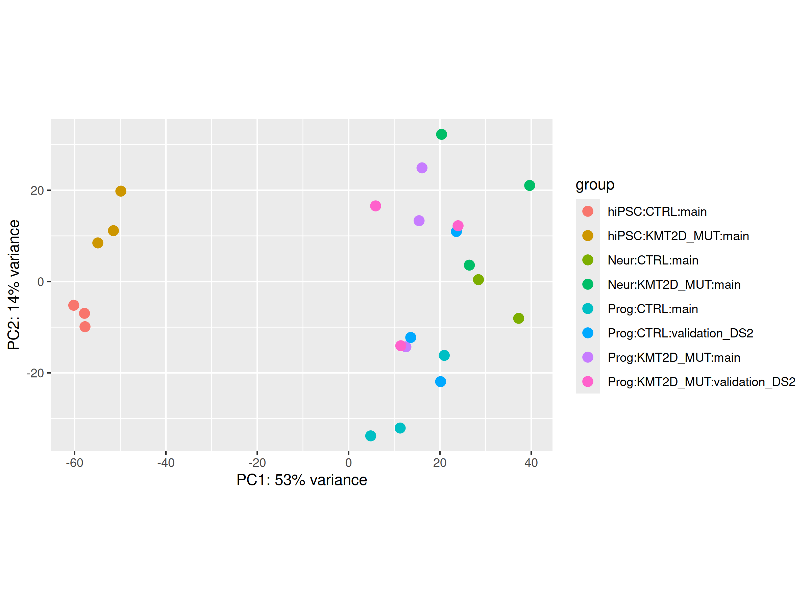
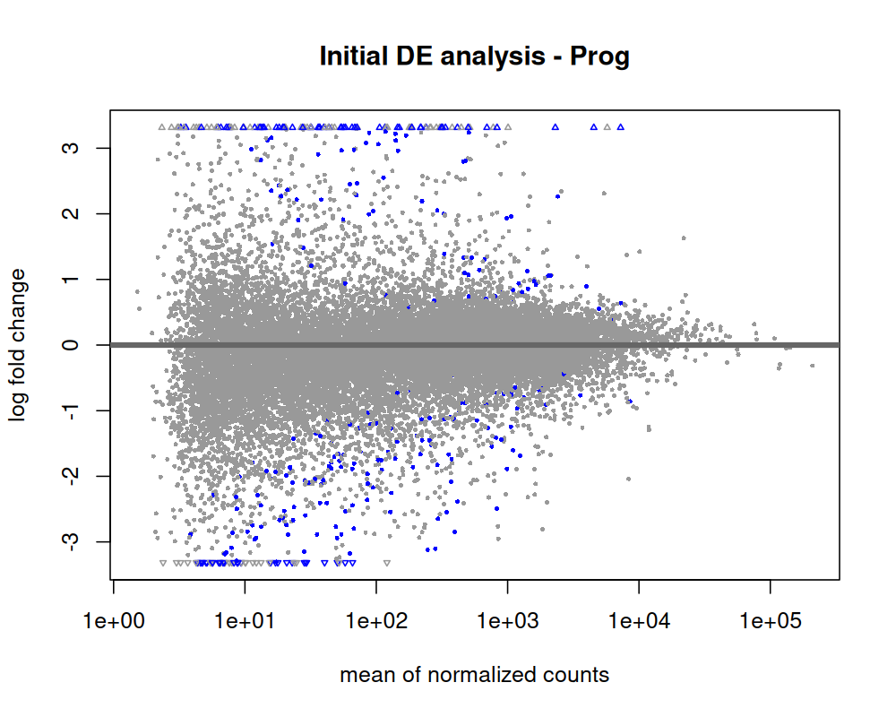
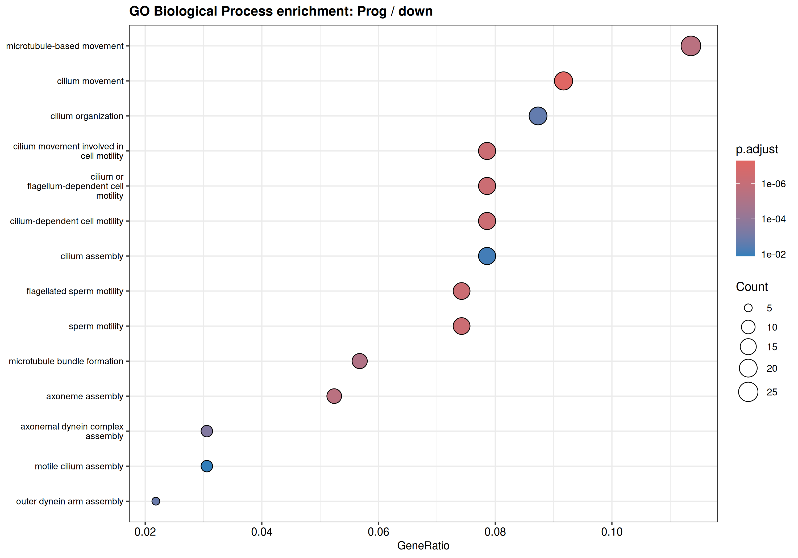
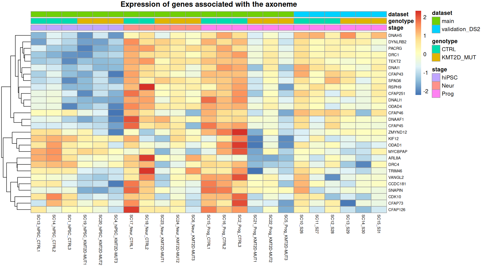

# Transcriptomic Analysis of KMT2D-Associated Kabuki Syndrome

## Project overview

This project investigates gene expression changes associated with KMT2D mutations during human neuronal differentiation.

Using publicly available RNA-seq data from the Gene Expression Omnibus (GEO), the analysis explores transcriptional differences between control and KMT2D-mutant samples across three developmental stages: human induced pluripotent stem cells (hiPSC), neural progenitors (Prog), and neurons (Neur).

The objective was to build a reproducible RNA-seq analysis workflow, identify differentially expressed genes, and explore their associated biological processes.

**Dataset:** [GSE289159 – NCBI GEO](https://www.ncbi.nlm.nih.gov/geo/query/acc.cgi?acc=GSE289159)

## Objectives

- Explore and preprocess RNA-seq count data.
- Assess sample structure and variability through exploratory analysis.
- Identify differentially expressed genes between control and KMT2D-mutant samples.
- Investigate functional patterns using Gene Ontology enrichment analysis.
- Compare selected findings with results reported in the original publication.

## Dataset

The dataset contains RNA-seq count data from three stages of neuronal differentiation:

| Stage | Control samples | KMT2D-mutant samples |
|---|---:|---:|
| hiPSC | 3 | 3 |
| Neural progenitors | 6* | 6 |
| Neurons | 2 | 3 |
| **Total** | **11** | **12** |

*The neural progenitor group includes samples from the main dataset and an additional validation dataset.*

The initial count matrix contained 57,820 genes and 23 samples. Following low-expression filtering, 20,824 genes were retained for downstream analysis.

## Analysis workflow

### 1. Data preparation and quality assessment

- Imported raw gene count data and sample metadata.
- Checked sample identifiers and metadata consistency.
- Filtered lowly expressed genes.
- Examined library sizes and detected gene counts.
- Normalized counts using DESeq2 size factors.

### 2. Exploratory data analysis

Principal Component Analysis (PCA) was used to investigate sample variability and assess the relationships between developmental stages and genotypes.

### 3. Differential expression analysis

Differential expression analysis was performed using **DESeq2**.

The statistical model included developmental stage, genotype, and their interaction:

`~ stage * genotype`

Control and KMT2D-mutant samples were compared within each developmental stage.

### 4. Functional enrichment analysis

Gene Ontology Biological Process enrichment analysis was performed using **clusterProfiler**.

Upregulated and downregulated gene sets were investigated separately, using stage-specific tested genes as the background universe.

### 5. Targeted biological investigation

A subset of genes associated with cilium organization and motility was examined across developmental stages.

Normalized expression levels were visualized to investigate the consistency of the observed transcriptional changes across individual samples.

## Key findings

The analysis identified stage-dependent transcriptional differences between control and KMT2D-mutant samples.

The most prominent functional enrichment signal was observed among downregulated genes in neural progenitors. Enriched biological processes included cilium organization, axoneme assembly, dynein assembly, and cilium movement.

A targeted analysis of 28 genes associated with these processes showed a consistent decrease in expression in the neural progenitor group.

### Comparison with published findings

The differential expression analysis was compared with findings reported by Cuvertino et al. in their study of KMT2D-related Kabuki syndrome.

All eight selected genes showed expression changes in the same direction as reported in the publication. Four genes associated with neuronal projection guidance and cilium organization (FEZ1, VANGL2, CDK10, DNALI1) were downregulated, while four genes associated with epithelial morphogenesis and embryonic development (AJAP1, IRX2, TBX1, EN2) were upregulated.

Six of the eight genes reached statistical significance after multiple-testing correction (adjusted p-value < 0.05). FEZ1 and EN2 showed concordant directions but did not meet this threshold.

This comparison provides evidence of consistency between the reanalysis and the published observations. However, since the analysis uses data from the same study, it should not be interpreted as an independent replication.

## Selected visualizations

### 1. Principal Component Analysis

PCA illustrating sample distribution across developmental stages and genotypes.

### 2. Differential expression in neural progenitors

MA plot showing differential expression between control and KMT2D-mutant neural progenitor samples.

### 3. Functional enrichment of downregulated genes

Gene Ontology Biological Process enrichment highlighting processes associated with cilium organization, axoneme assembly and cilium movement.

### 4. Expression of cilium-associated genes

Normalized expression of selected cilium-associated genes across individual control and KMT2D-mutant neural progenitor samples from the main dataset.

## Limitations

Several limitations should be considered when interpreting the results:

- Genotype is confounded with inferred sex in the main cohort, preventing the specific attribution of observed expression differences to KMT2D mutations.
- Sample sizes are limited, particularly for the neuronal stage.
- Transcript abundance does not directly establish protein abundance or biological function.
- The functional enrichment results are hypothesis-generating and require further experimental investigation.
- Comparison with the original publication is based on the same underlying dataset and is not an independent validation.

## Tools and technologies

- **R**
- **DESeq2** – differential expression analysis
- **clusterProfiler** – functional enrichment analysis
- **org.Hs.eg.db** – gene annotation
- **ggplot2** – data visualization
- **Git / GitHub** – version control

## Repository structure

project/
├── data
│   └── raw
│       └── GSE289159_GeneCounts_allSamples.txt.gz
├── R
│   ├── 01_sample_description.R
│   ├── 02_initial_analysis.R
│   ├── 03_sex_qc.R
│   ├── 04_improved_analysis.R
│   ├── 05_biological_interpretation.R
│   ├── 06_functional_enrichment.R
│   ├── 07_targeted_cilia_analysis.R
│   └── 08_concluding_analysis.R
├── README.md
├── results/
│   └── figures/
└── R-GSE289159.Rproj

## Reproducibility

The analysis scripts are provided to document the workflow and reproduce the main results.

Raw data are available from the NCBI Gene Expression Omnibus under accession **GSE289159**.

See the individual scripts for the analysis steps and required R packages.

## Reference

Cuvertino et al. (2025). *Epigenome and transcriptome changes in KMT2D-related Kabuki syndrome Type 1 iPSCs, neuronal progenitors and cortical neurons*. PLOS Genetics.

